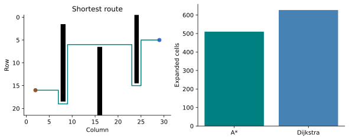

# A* Grid Planning

Find a shortest route across a four-connected occupancy grid and count how much of the grid each search expands.

Every step costs one. Manhattan distance is a consistent lower bound on the remaining cost on this grid. A* expands a node of least accumulated cost plus heuristic. Dijkstra uses the same queue discipline with the heuristic set to zero. Both should return the same optimal length.

[Worked notebook](a_star_grid_planning.ipynb) · [Python script](a_star_grid_planning.py)

## Search the floor plan

Compare against the separate SciPy graph shortest-path routine, including a test in which the goal is isolated.

## Recorded output

```text
Optimal distance 62 cells | expanded by A*: 510, by Dijkstra: 627
```

## Interpreting the result

Expansion counts depend on queue tie-breaking. Agreement with the independent shortest-path distance tests optimality on this instance.



## Exercise

Change to eight-connected motion and derive an admissible heuristic for the new step costs.

## References

[Hart, Nilsson and Raphael, A Formal Basis for the Heuristic Determination of Minimum Cost Paths](https://doi.org/10.1109/TSSC.1968.300136)

[SciPy graph shortest paths](https://docs.scipy.org/doc/scipy/reference/generated/scipy.sparse.csgraph.shortest_path.html)
