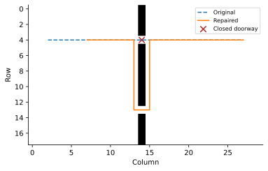

# D* Lite Replanning

Repair a route after a doorway closes while the robot is already partway along its journey.

D* Lite searches backwards from the goal. Each vertex stores a current cost and a one-step lookahead cost. A changed edge makes nearby vertices inconsistent. A priority queue propagates repairs until the current start has a consistent value. Moving the start updates the heuristic offset.

[Worked notebook](d_star_lite.ipynb) · [Python script](d_star_lite.py)

## Close a doorway and repair the existing search

Compare the old path, the repaired route and the independent shortest length on the changed map. The search object is reused across the change.

## Recorded output

```text
Original steps 25 after closure 38 after reopening 20
Queue pops on initial plan and repair 26 287
```

## Interpreting the result

A repair can still require substantial work if the changed edge affects many shortest paths. The reference length also checks the response to reopening.



## Exercise

Close both doorways, check that the route becomes empty and reopen only the lower one.

## References

[Koenig and Likhachev, D* Lite (2002)](https://publications.ri.cmu.edu/d-lite)
