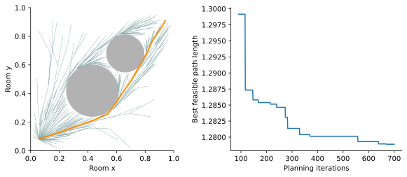

# Informed RRT*

Plan a collision-free route through a continuous two-dimensional room and track how its cost improves.

RRT* selects a low-cost parent and rewires neighbours when a better path becomes available. After the first solution, Informed RRT* samples uniformly in the ellipse whose foci are the start and goal and whose major axis is the best route length. Outside that ellipse a Euclidean route cannot improve the incumbent.

[Worked notebook](informed_rrt_star.ipynb) · [Python script](informed_rrt_star.py)

## Grow and rewire the tree

A line-segment distance check tests every returned edge against each circular obstacle. Descendant costs are updated after rewiring.

## Recorded output

```text
First solution at iteration 91 | first and last length [1.2992 1.2789] | accepted nodes 456
```

## Interpreting the result

The curve is a best-so-far cost for one seeded run. Collision-free edges and monotonically improving cost can be checked directly. A finite run gives no certificate of global optimality.



## Exercise

Compare several seeds and report the distribution of time to first solution.

## References

[Gammell, Srinivasa and Barfoot, Informed RRT*](https://arxiv.org/abs/1404.2334)

[Karaman and Frazzoli, Sampling-based Algorithms for Optimal Motion Planning](https://arxiv.org/abs/1105.1186)
