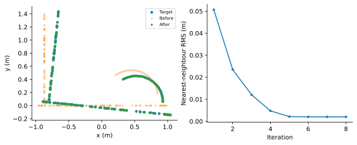

# Iterative Closest Point

Estimate a planar rigid transform between two point clouds when point correspondences are initially unknown.

Each iteration pairs transformed source points with their nearest target points and fits an orientation-preserving least-squares rigid transform by singular value decomposition. The updates compose in the same coordinate convention. The experiment has a known ground-truth rotation and translation.

[Worked notebook](iterative_closest_point.ipynb) · [Python script](iterative_closest_point.py)

## Register an asymmetric shape

The fixture uses irregularly spaced points along an L and an arc. Source order is shuffled so row correspondence cannot help the estimator.

## Recorded output

```text
Point-to-set RMS 0.00204 | translation error 0.00009 | iterations 8
```

## Interpreting the result

ICP is a local method. A distant initial pose or a symmetric object can produce a plausible residual at an incorrect registration.



## Exercise

Increase the initial rotation until the point error and recovered rotation tell different stories.

## References

[Besl and McKay, A Method for Registration of 3-D Shapes (1992)](https://doi.org/10.1109/34.121791)
