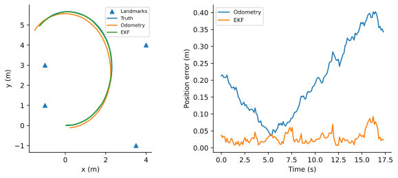

# Extended Kalman Filter Localisation

Fuse uncertain wheel motion with intermittent range and bearing observations of known landmarks.

The prediction linearises a unicycle model. The update linearises the sensor model at the current pose and wraps bearing errors at ±π. A Joseph-form covariance update preserves numerical symmetry and positive semidefiniteness to rounding precision.

[Worked notebook](ekf_localisation.ipynb) · [Python script](ekf_localisation.py)

## Compare odometry with landmark updates

The estimator and odometry-only baseline receive exactly the same noisy velocity measurements. Truth is retained solely for scoring.

## Recorded output

```text
Position RMSE (m), odometry / EKF [0.2257 0.0343] | EKF heading RMSE (rad) 0.0131
```

## Interpreting the result

The measured benefit depends on noise, landmark geometry and observation rate. Landmark correspondences and map coordinates are supplied in this problem.



## Exercise

Reduce measurement frequency and examine how position and heading drift change.

## References

[Dellaert and Hutchinson, Introduction to Robotics and Perception](https://www.roboticsbook.org/)

[Welch and Bishop, an introduction to the Kalman filter](https://www.cs.unc.edu/~welch/kalman/)
