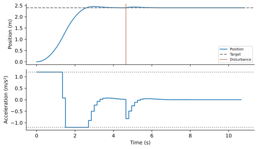

# Constrained Model Predictive Control

Move a one-dimensional cart to a target without exceeding a bound on acceleration.

Stack a double integrator over a finite horizon and penalise position error, velocity and acceleration. Condensing eliminates the future states, leaving a convex bounded least-squares problem. Apply the first control and solve again from the next measured state.

[Worked notebook](constrained_mpc.ipynb) · [Python script](constrained_mpc.py)

## Compare bounded control with an open-loop baseline

The cart starts from rest. The upper and lower actuator bounds enter the optimiser directly. A brief velocity disturbance tests replanning.

## Recorded output

```text
Final position error 6.061e-08 m | final speed 4.111e-08 m/s | maximum effort 1.2000 m/s²
Stationary baseline final position error (m) 2.4
```

## Interpreting the result

A longer horizon lets the optimiser anticipate braking earlier. The only hard constraint in this exercise is the acceleration bound.



## Exercise

Halve the acceleration bound and compare settling time and maximum overshoot.

## References

[Rawlings, Mayne and Diehl, Model Predictive Control](https://sites.engineering.ucsb.edu/~jbraw/mpc/)

[OSQP, model predictive control example](https://osqp.org/docs/examples/mpc.html)
