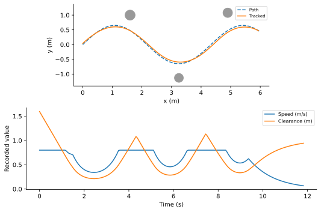

# Regulated Pure Pursuit

Track a curved indoor path while adjusting speed for curvature, obstacle proximity and the remaining distance.

The target point sits a velocity-scaled arc length ahead. Its lateral displacement in the robot frame determines curvature. Speed is capped by curvature, geometric clearance and goal proximity. A forward projection can request a stop if the modelled footprint intersects an obstacle. This small forward-only implementation follows the ideas in the regulated pure pursuit paper.

[Worked notebook](regulated_pure_pursuit.ipynb) · [Python script](regulated_pure_pursuit.py)

## Track the reference and examine the speed trace

The centreline, circular obstacle map and robot radius are known. Clearance is measured from the footprint boundary. The simulation uses a discrete forward collision check.

## Recorded output

```text
Goal error 0.070 m | cross-track RMS 0.038 m | minimum sampled clearance 0.214 m
```

## Interpreting the result

A positive clearance is a result for this map and time sampling. This lab uses Euclidean distances and a circular footprint. The Nav2 controller also supports costmap and platform-specific settings.



## Exercise

Move one obstacle towards the reference and compare speed reduction with the location of the predicted stop.

## References

[Macenski et al., Regulated Pure Pursuit for Robot Path Tracking (2023)](https://arxiv.org/abs/2305.20026)

[Nav2, regulated pure pursuit](https://docs.nav2.org/configuration/packages/configuring-regulated-pp.html)
