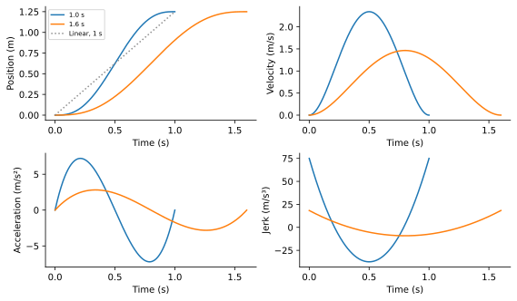

# Minimum-Jerk Trajectories

Generate a smooth rest-to-rest motion with specified endpoint position, velocity and acceleration.

Minimising integrated squared jerk for a point with zero endpoint velocity and acceleration gives a fifth-order polynomial. For normalised time u, the progress law is 10u³ − 15u⁴ + 6u⁵. Differentiating with respect to physical time introduces one factor of inverse duration per derivative.

[Worked notebook](minimum_jerk_trajectories.ipynb) · [Python script](minimum_jerk_trajectories.py)

## Check the boundary conditions

Compare the polynomial trajectory with linear progress, then inspect velocity, acceleration and jerk under two movement durations.

## Recorded output

```text
Duration 1.0 s | peak speed 2.344 m/s | integrated squared jerk 1125.045
Duration 1.6 s | peak speed 1.465 m/s | integrated squared jerk 107.293
```

## Interpreting the result

Stretching the same path in time reduces integrated squared jerk in proportion to T⁻⁵. A physical arm would also require joint and actuator checks.



## Exercise

Double the duration and verify the predicted ratio of the two jerk energies.

## References

[Flash and Hogan, coordination of arm movements (1985)](https://doi.org/10.1523/JNEUROSCI.05-07-01688.1985)
