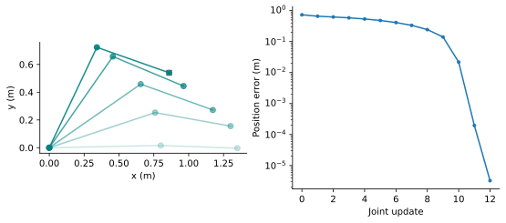

# Damped Least-Squares Inverse Kinematics

Move a planar arm towards a reachable target using a regularised Jacobian inverse.

A two-link arm maps joint angles to a Cartesian endpoint. Near a straight-arm configuration its Jacobian is poorly conditioned. The damped least-squares correction solves a local approximation with a penalty on joint displacement. The damping improves numerical behaviour at the cost of slower convergence.

[Worked notebook](damped_inverse_kinematics.ipynb) · [Python script](damped_inverse_kinematics.py)

## Check the differential model and reach the target

Finite differences independently verify the analytic Jacobian. Bound the step size and record the remaining Cartesian error after each update.

## Recorded output

```text
Initial error 0.7313 m | final 3.25e-06 m | updates 12
```

## Interpreting the result

The endpoint criterion measures task-space error. Different elbow configurations can reach the same target.



## Exercise

Move the target just outside the reachable workspace and record what the residual and joint updates do.

## References

[Wampler, damped least-squares inverse kinematics](https://doi.org/10.1109/TSMC.1986.289285)
