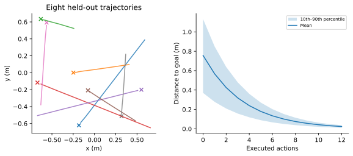

# Diffusion Policies for Reaching

Learn short actions for a simulated tabletop point moving towards a goal from offline demonstrations.

A neural network predicts clean action chunks from noisy chunks, a diffusion timestep and the vector to the goal. A deterministic DDIM-style reverse schedule samples six actions. The robot executes two actions before replanning. This state-conditioned exercise isolates the action diffusion and receding-horizon components of Diffusion Policy.

[Worked notebook](diffusion_policy.ipynb) · [Python script](diffusion_policy.py)

## Train on generated demonstrations

The deterministic demonstrator removes one quarter of the remaining displacement per tick. The network receives the state displacement and a noisy action chunk. All network parameters are fitted from scratch.

## Evaluate closed-loop reaching

Use 60 new start-goal pairs and fresh sampling noise. Report one-chunk action RMSE, terminal distance, success within 8 cm and the initial-distance baseline.

## Recorded output

```text
Gradient updates 1250 | mean objective, first and last 100 [8.266e-02 4.000e-05]
Action RMSE 0.0006 m/tick | mean distance before 0.757 m | after 0.024 m
Within 8 cm: 60 of 60
```

## Interpreting the result

This is a unimodal task with a known analytic expert. The result checks conditional generation and feedback during rollout. It does not measure physical robot performance or the ability to model multimodal demonstrations.



## Exercise

Execute all six actions before replanning and compare terminal error across the same held-out starts.

## References

[Chi et al., Diffusion Policy (2023)](https://diffusion-policy.cs.columbia.edu/)

[Song, Meng and Ermon, Denoising Diffusion Implicit Models](https://arxiv.org/abs/2010.02502)
