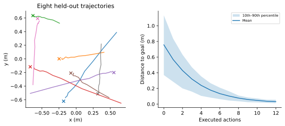

# Conditional Flow Matching for Reaching

Learn short actions for a simulated tabletop point moving towards a goal from offline demonstrations.

Pairs of Gaussian noise and demonstrated action chunks define straight interpolation paths. A neural network learns the velocity along those paths, conditioned on time and the current displacement to the goal. At inference an Euler integrator transports Gaussian samples towards actions. It applies the conditional flow-matching objective to a small control task.

[Worked notebook](flow_matching_policy.ipynb) · [Python script](flow_matching_policy.py)

## Train on generated demonstrations

The deterministic demonstrator removes one quarter of the remaining displacement per tick. The network receives the state displacement and a noisy action chunk. All network parameters are fitted from scratch.

## Evaluate closed-loop reaching

Use 60 new start-goal pairs and fresh sampling noise. Report one-chunk action RMSE, terminal distance, success within 8 cm and the initial-distance baseline.

## Recorded output

```text
Gradient updates 1250 | mean objective, first and last 100 [0.69964 0.06154]
Action RMSE 0.0096 m/tick | mean distance before 0.757 m | after 0.032 m
Within 8 cm: 60 of 60
```

## Interpreting the result

This is a unimodal task with a known analytic expert. The result checks conditional generation and feedback during rollout. It does not measure physical robot performance or the ability to model multimodal demonstrations.



## Exercise

Execute all six actions before replanning and compare terminal error across the same held-out starts.

## References

[Lipman et al., Flow Matching for Generative Modeling](https://arxiv.org/abs/2210.02747)

[Tong et al., Conditional Flow Matching](https://arxiv.org/abs/2302.00482)
